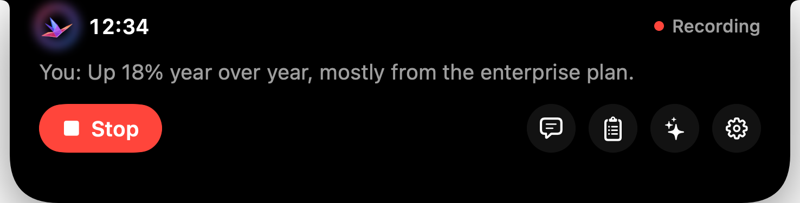
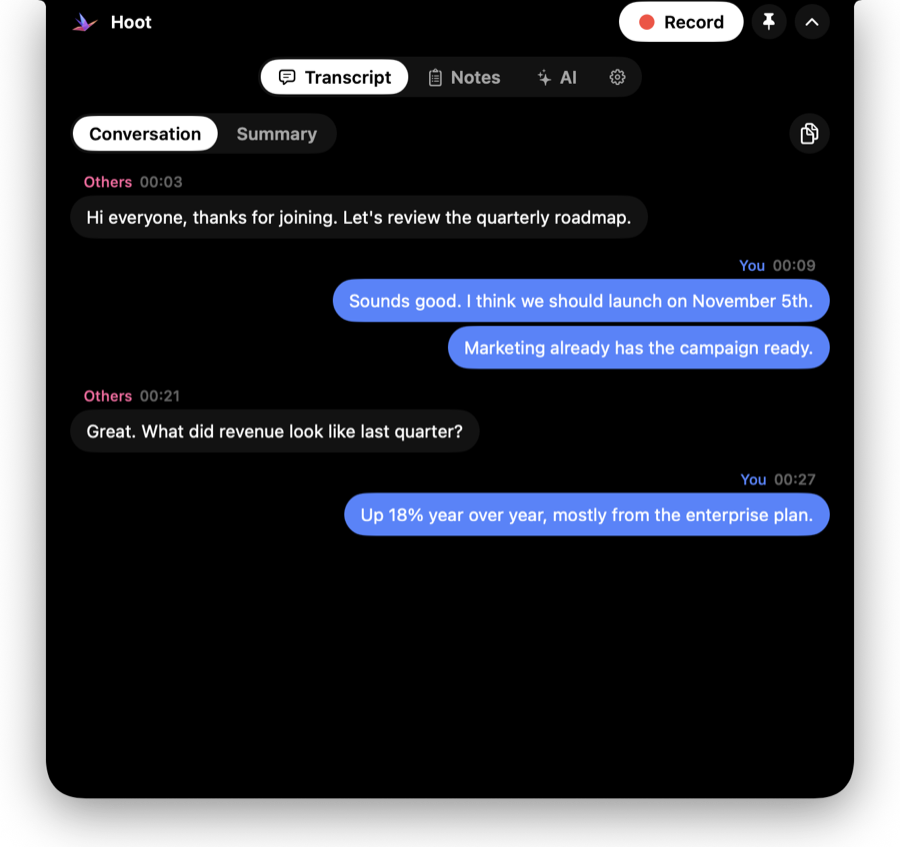
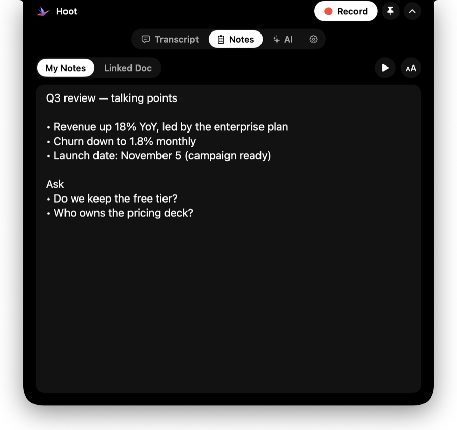
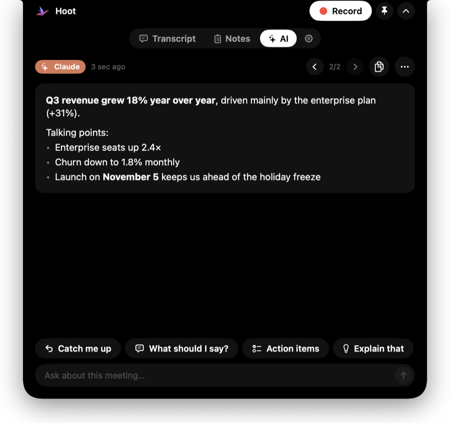

<p align="center">
  
</p>

<h1 align="center">Hoot</h1>

<p align="center">
  <strong>Private meeting notes for your Mac.</strong><br>
  Lives in the notch. Transcribes both sides of any call on-device. Hands you the summary when you hang up.
</p>

<p align="center">
  <a href="https://github.com/Sagar-Darji/hoot/actions/workflows/build.yml"></a>
  <a href="https://github.com/Sagar-Darji/hoot/releases/latest"></a>
</p>

<p align="center">
  <a href="https://github.com/Sagar-Darji/hoot/releases/latest/download/Hoot.dmg"><b>⬇︎ Download Hoot</b></a> ·
  <a href="https://sagar-darji.github.io/hoot/">Website</a> ·
  <a href="CHANGELOG.md">Changelog</a>
</p>

<p align="center">
  
</p>

## Features

- **Lives in the notch** — a Dynamic Island for your MacBook: timer and live voice bars while recording; point at the notch for Record and quick links, and Transcript, Notes, AI and Settings all open right inside the island. Macs without a notch get the same island at the top of the screen.
- **Both sides, on-device** — your microphone and the call's audio are transcribed separately with [whisper.cpp](https://github.com/ggml-org/whisper.cpp). Works with Zoom, Meet, Teams, FaceTime, Slack and anything else that plays sound.
- **Summary & action items** — when you stop, Apple Intelligence writes the summary, decisions, action items and open questions, on-device.
- **Speaker notes** — a cue card beside the call, a linked doc (Google Docs/Slides/Sheets, GitHub, any page) that stays up to date, and a teleprompter.
- **AI Assist** — answers from Claude, ChatGPT and Gemini appear beside the call (read automatically, copied, or sent from your phone), and you can *Ask about this meeting*.
- **Invisible when sharing** — Hoot is excluded from screen sharing and recordings.
- **Light** — under 100 MB at rest with no CPU use; the speech engine loads only during meetings and is released a few minutes after. Animations follow your voice levels instead of a timer, so silence costs nothing.

| Transcript | Speaker notes | AI Assist |
| --- | --- | --- |
|  |  |  |

## Install

Needs a Mac with Apple Silicon (M1 or newer) and **macOS 26** or later.

1. Download [**Hoot.dmg**](https://github.com/Sagar-Darji/hoot/releases/latest/download/Hoot.dmg), open it and drag Hoot onto the Applications folder.
2. Open Hoot. If macOS says it can't verify the app, click **Done**, then go to **System Settings › Privacy & Security** and click **Open Anyway** (once).
3. Follow the Setup checklist: allow the **Microphone** and **Screen & System Audio Recording**, reopen Hoot, and let it download the speech model (≈550 MB, once).
4. Press **⌃⌥R** in any app (or click Record in the notch) to take notes.

Notes are Markdown files in `~/Documents/Meeting Notes/`. Nothing is uploaded anywhere — please tell people when you're recording.

## How it works

| Piece | What it does |
| --- | --- |
| `Audio/` | Captures the mic (`AVAudioEngine`, echo-cancelled) and the call's audio (`ScreenCaptureKit`, audio only) as two 16 kHz tracks, splits each into speech chunks at pauses. |
| `Transcription/` | Runs a bundled `whisper-server` (whisper.cpp + Metal) on demand; summaries and *Ask* use Apple's on-device Foundation Models. |
| `Recorder.swift` | Session lifecycle, transcription queue, files, and the speech engine's load/unload. Voice levels live in a separate `LiveMeter` so only the meter redraws while recording. |
| `UI/` | The notch island — Hoot's only window, with Transcript · Notes · AI · Settings inside it — built on one design system (`Theme.swift`); the glass crane renderer; the install window's background. |
| `Assist/` | AI Assist: reading Claude/ChatGPT/Gemini via Accessibility, the clipboard, and a token-protected Wi-Fi drop page. |
| `System/` | Global shortcuts, call detection, launch at login, update checks. |

## Build from source

```sh
brew install whisper-cpp            # the speech engine that gets bundled into the app
./make-signing-cert.sh              # once: a stable local signing identity (keeps macOS permissions across builds)
./build.sh install                  # builds Hoot.app, bundles the engine, installs and opens it
```

Useful flags on the built binary (`.build/release/MeetingNotes`): `--transcribe-file <audio>`, `--summarize-demo`, `--fetch-doc <link>`, `--render-icon <png>`, `--render-island <dir>`, `--render-installer <dir>`.

`HOOT_SHOWCASE=<tab>` opens the island with sample content for screenshots (`live`, `live-transcript`, `notes`, `assist`, `settings`, …); `HOOT_SHOWCASE=bench` steps through every state and prints dropped frames and CPU for each; `HOOT_SLOWMO=10` slows the island's animations down to check them frame by frame.

`./package.sh` makes the disk image with the classic install window (drag Hoot onto Applications). Its background and Finder layout live in `Resources/dmg`.

## Releasing an update

```sh
./release.sh          # patch: 1.0.0 → 1.0.1
./release.sh minor    # 1.0.1 → 1.1.0
```

`release.sh` bumps [`VERSION`](VERSION), writes the [changelog](CHANGELOG.md) from the commits since the last release, tags, builds and signs the app, packages the `.dmg`, pushes and publishes a GitHub release with **Hoot.dmg** attached. The website's download button always points at the latest release, and Hoot checks for updates once a day. CI compiles every push on macOS 26.

## License

[MIT](LICENSE). Bundled and downloaded third-party components are listed in [THIRD_PARTY_NOTICES.md](THIRD_PARTY_NOTICES.md).
